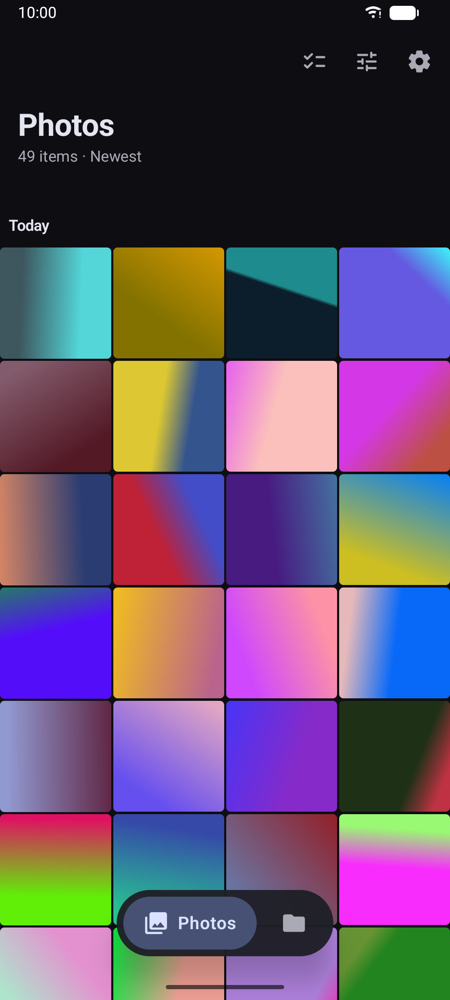
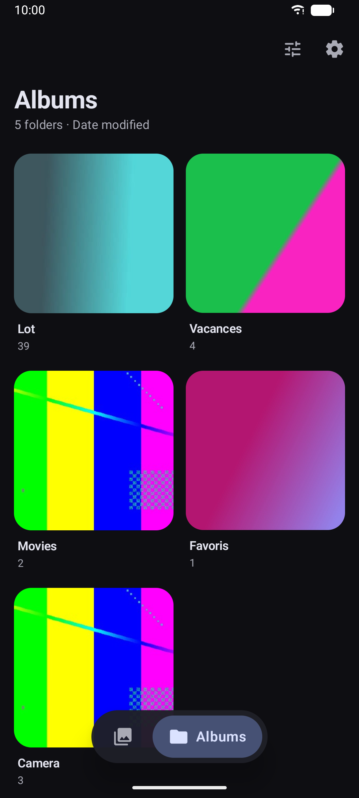
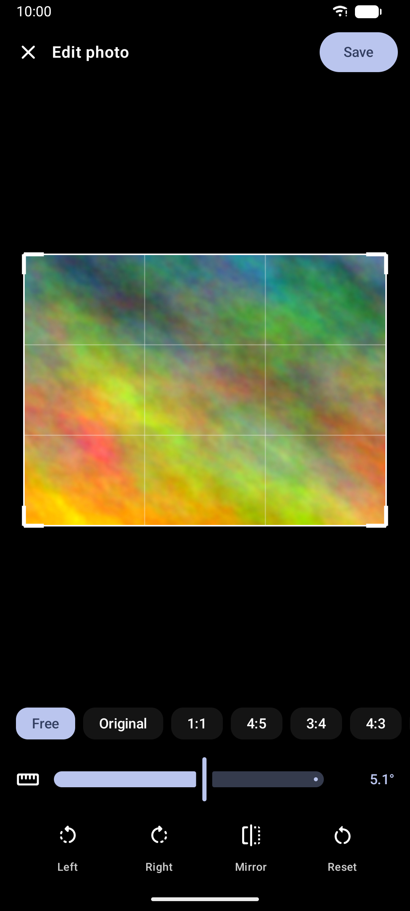

# Gallery

A fast, private photo & video gallery for Android. No ads, no trackers, no internet access.

> [!NOTE]
> This app was fully vibecoded at the very beginning: the initial version was written entirely
> by an AI coding assistant (Claude Code), from my descriptions of what I wanted.

<p>
  
  
  
</p>

## Features

- **Photos** view grouped by day — sort by date, name, size or randomly; filter photos/videos; 2 to 6 columns
- **Albums** view — sort folders by date modified, date created or name
- **Selection** — long-press and drag to select many items, with auto-scroll; select a whole day or everything
- **Move** items between folders (or into a new one), **share**, **delete** (to trash)
- **Photo editor** — crop (free or fixed ratio), rotate, mirror
- **Video editor** — trim with a live preview, crop, rotate, mirror
- **Save** as a copy or replace the original — choose each time or set a default, separately for photos and videos
- Keeps photo EXIF data (date, camera, optionally GPS location)
- Material You design, light/dark/pure-black themes
- English and French

## Privacy

The app has **no internet permission**: nothing ever leaves your phone.
It only needs access to your photos and videos. The optional "media management" permission (Android 12+)
lets it edit, move and delete files without Android asking for confirmation each time.

## Building

Requirements: JDK 17 or newer (the one bundled with Android Studio works), Android SDK 37.

```bash
./gradlew :app:assembleDebug     # debug APK
./gradlew :app:assembleRelease   # release APK (unsigned)
```

To install a release build directly on your phone, add `signReleaseWithDebugKey=true` to `local.properties`,
then run `./gradlew :app:installRelease`.

## License

Copyright (C) 2026 Yalaouf

This program is free software: you can redistribute it and/or modify it under the terms of the
GNU General Public License as published by the Free Software Foundation, either version 3 of the License,
or (at your option) any later version. See [LICENSE](LICENSE).
