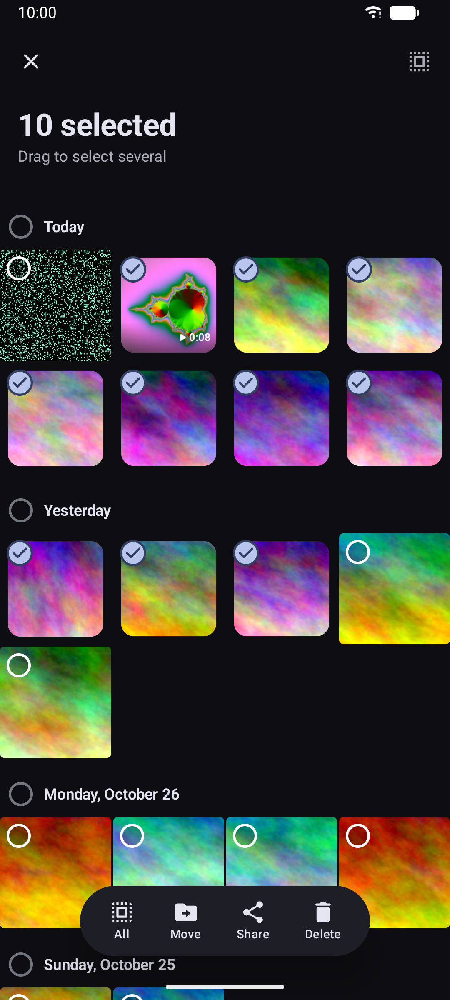
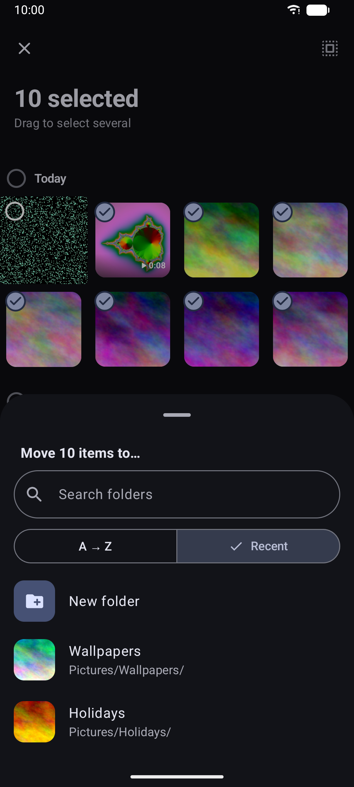
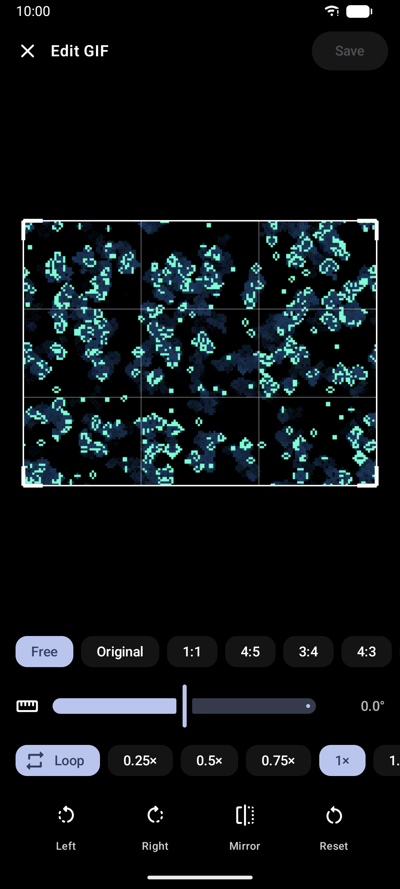
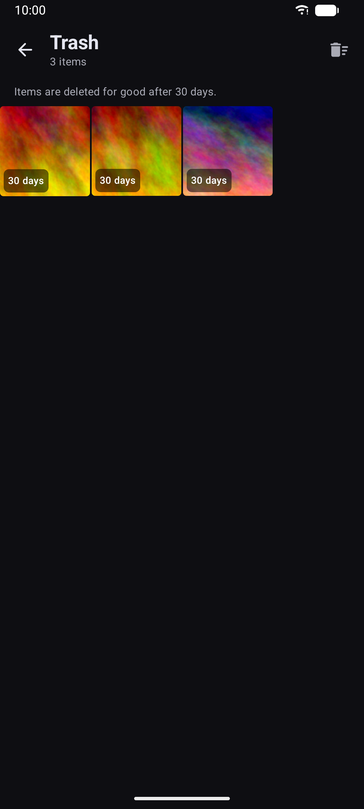
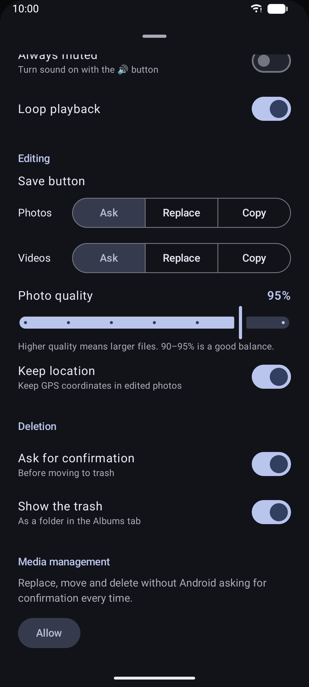

# Gallery

A fast, private photo & video gallery for Android, with photo, GIF and video editing.
No ads, no trackers, no internet access.

> [!NOTE]
> This app was fully vibecoded from the very beginning
> by an AI coding assistant (Claude Code), from my descriptions of what I wanted.

<p>
  
  
  
  
</p>
<p>
  
  
  
  
</p>

## Download

Get the latest APK from the [**Releases page**](https://github.com/Yalaouf/gallery-android/releases/latest)
(`gallery-vX.Y.Z.apk`). Android 11 or newer is required.

The APK is signed with this certificate (SHA-256), which you can check with
`apksigner verify --print-certs gallery-vX.Y.Z.apk`:

```
E8:BB:B4:0D:FF:52:90:91:5A:14:38:5E:68:03:AF:41:84:B4:5D:F5:D9:33:1D:77:2C:E6:66:73:65:84:39:90
```

An F-Droid release is planned.

## Features

**Browse**
- **Photos**: everything grouped by day. Sort by date, name, size or randomly, show only photos or videos, choose 2 to 6 columns
- **Albums**: your folders, sorted by date modified, date created or name, with a search bar. Pin your favorite
  albums to the top, and hide noisy folders (WhatsApp, screenshots…) from Photos
- **Collections**: **On this day** (photos taken on today's date in previous years, also shown at the top of Photos),
  **Favorites**, all **Photos**, all **Videos**, the **trash** and the **locked folder**
- **Fast scroller**: drag the scrollbar to jump to any month
- Full-screen viewer with pinch and double-tap zoom, animated GIFs, a video player with its own controls, and swipe up or down to close
- **Slideshow**, and detailed info: camera, lens, exposure, frame rate, location (with "Open in Maps")
- Videos start muted in split screen, so the other app (e.g. YouTube) keeps playing

**Organize**
- Long-press and drag to select many items; the grid scrolls by itself at the edges. Select a whole day or everything
- **Favorite**, **move** or **copy** items to another folder or a new one, with folder search and an A → Z / recent sort
- **Create**, **rename** and **delete albums**, and **rename** files
- **Edit the date taken** of one item or a whole selection (shift them all, or set one date), written into the file
  so other apps agree
- **Remove the location** from the original photo, not only from shared copies
- **Locked folder**: hide photos and videos from the gallery and from other apps, behind your fingerprint or screen lock
- **Set as** wallpaper or contact picture
- **Share** and **delete**; deleted items go to the **trash**, where they can be restored for 30 days or deleted for good
- Instant refresh after deleting, replacing or moving

**Edit**
- **Photos**: crop (free or fixed ratios), rotate, **straighten by any angle** (with automatic zoom so no empty corners show), mirror,
  adjust light, contrast, color and warmth, **draw**, and **pixelate** faces, plates or text to hide them
- **GIFs**: the same tools, plus speed (0.25× to 4×) and looping
- **Videos**: trim with a live preview, crop, rotate, mirror, change speed (0.25× to 4×), remove the sound, save a frame as a photo
- **Video to GIF**: export up to 15 seconds as an animated GIF, at the video's speed, 10 to 50 fps, up to 1080 px
- Save as a copy or replace the original: ask each time or set a default, separately for photos and videos
- Keeps photo EXIF data (date, camera, and optionally the GPS location)
- Opens images and videos from other apps: "Edit with", "Open with", and "Edit with Gallery" in the share menu
  (handy for screenshots, whose Edit button always opens the system editor)

**Look**
- Material You design, light / dark / pure-black themes, wallpaper colors
- Light or dark app icon, or automatic (follows the system theme on launchers that support it)
- English and French, following the system language (or the per-app language on Android 13+)

See [CHANGELOG.md](CHANGELOG.md) for what changed in each version. What comes next is planned in the [milestones](https://github.com/Yalaouf/gallery-android/milestones).

## Privacy

The app has **no internet permission**: nothing ever leaves your phone. There are no ads, trackers or analytics,
and the only libraries are AndroidX, Media3 and Coil.

- **Remove location when sharing** (optional, in Settings): shared photos are sent as copies without their GPS data.
- **Locked folder**: hidden items are moved to the app's private storage, where other apps can't see them.
  They are **hidden, not encrypted**: the fingerprint or screen lock protects access through the app, but someone
  with full access to the phone (a rooted phone, or a transfer to another phone) could read the files.
  They are excluded from cloud backups (a direct transfer to a new phone keeps them), and they are
  **deleted if you uninstall the app**: unhide them first.
- "Open in Maps" hands the coordinates to your maps app; Gallery itself never goes online.

It needs access to your photos and videos. Optional permissions:
- **Media management** (Android 12+): edit, move and delete without Android asking for confirmation every time.
- **Photo location**: lets Android hand the GPS location to the app, so it's kept in edited photos.
- **Fingerprint / face** (granted automatically): unlocks the locked folder.

## Building

Requirements: JDK 17 or newer (the one bundled with Android Studio works) and the Android SDK 37.

```bash
./gradlew :app:assembleDebug     # debug APK
./gradlew :app:assembleRelease   # release APK, unsigned unless a release key is configured
./gradlew :app:testDebugUnitTest # unit tests
```

The unit tests run on the computer, Android code included, thanks to [Robolectric](https://robolectric.org): locked folder
(including recovery and failed restores), photo edits checked pixel by pixel, location removal when sharing, sorting,
albums, selection, settings, icon choice, and the GIF encoder and decoder.

To install a release build directly on your phone, either configure a release key (below) or add
`signReleaseWithDebugKey=true` to `local.properties`, then run `./gradlew :app:installRelease`.

## Releasing

Pushing a `v*` tag (e.g. `v1.1.5`) runs the [release workflow](.github/workflows/release.yml): it builds and tests the
app, signs the APK and publishes a GitHub release with that version's notes from `CHANGELOG.md`.
To publish an existing tag (e.g. an older version), run the workflow manually from the Actions tab and enter the tag;
such releases are not marked as "Latest".

Signing uses the release key from these sources, in order:
- `local.properties` on a development machine: `release.storeFile`, `release.storePassword`, `release.keyAlias`, `release.keyPassword`
- environment variables in CI, fed by the repository secrets `RELEASE_KEYSTORE_BASE64`, `RELEASE_KEYSTORE_PASSWORD`,
  `RELEASE_KEY_ALIAS` and `RELEASE_KEY_PASSWORD`

Without a key the release APK is unsigned, which is what F-Droid expects (it signs the APK itself).

For each version: bump `versionCode` and `versionName` in `app/build.gradle.kts`, add
`fastlane/metadata/android/{en-US,fr-FR}/changelogs/<versionCode>.txt` and a `CHANGELOG.md` entry, then tag.

## License

Copyright (C) 2026 Yalaouf

This program is free software: you can redistribute it and/or modify it under the terms of the
GNU General Public License as published by the Free Software Foundation, either version 3 of the License,
or (at your option) any later version. See [LICENSE](LICENSE).
